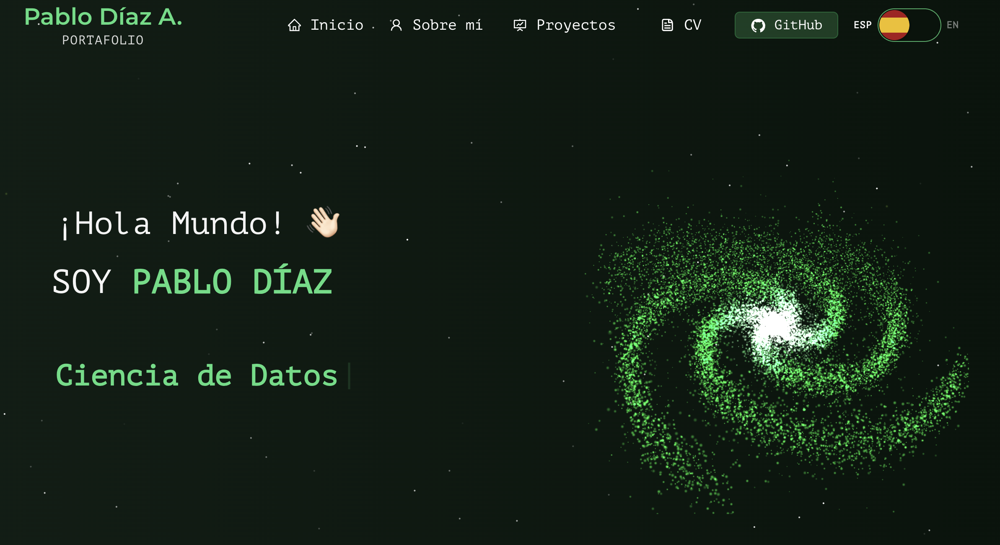

# Pablo Díaz | Portafolio

¡Hola! Soy Pablo Díaz, Licenciado en Astronomía y profesional interesado en la Ciencia de Datos. En este espacio comparto mi perfil, experiencia, habilidades y proyectos, además de mi interés por el aprendizaje automático y el análisis de datos científicos.

Puedes visitar el portafolio en [pablo-dz.github.io/Portfolio](https://pablo-dz.github.io/Portfolio).

## Créditos

Este sitio está basado en la plantilla [Portfolio de Soumyajit4419](https://github.com/soumyajit4419/Portfolio), adaptada con contenido, diseño y elementos visuales propios.
